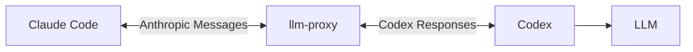

# llm-proxy

Proxy localhost cho phép **Claude Code dùng Codex qua tài khoản ChatGPT subscription**.
Hỗ trợ nhiều account và chuyển account khi xác nhận hết quota. Claude Code vẫn
thực thi tools, sửa file và chạy terminal.



## 1. Tải source

Cần Git; trên Ubuntu/WSL có thể cài bằng `sudo apt-get install -y git`.

```sh
git clone https://github.com/nghlong3004/llm-proxy.git
cd llm-proxy
```

Chọn **một** cách chạy dưới đây.

## 2A. Cài native trên Ubuntu / WSL

```sh
sudo apt-get update
sudo apt-get install -y build-essential pkg-config cmake curl ca-certificates
curl --proto '=https' --tlsv1.2 -sSf https://sh.rustup.rs | sh -s -- -y --profile minimal --default-toolchain 1.100.0
. "$HOME/.cargo/env"
cargo install --path . --locked --root "$HOME/.local"
export PATH="$HOME/.local/bin:$PATH"
```

Binary được cài tại `~/.local/bin/llm-proxy`. Thêm dòng PATH trên vào `~/.bashrc`
hoặc `~/.zshrc` để dùng ở terminal mới.

Đăng nhập và chạy nền:

```sh
llm-proxy accounts login --name personal --login-method device-code
install -D -m 644 packaging/systemd/llm-proxy.service ~/.config/systemd/user/llm-proxy.service
systemctl --user daemon-reload
systemctl --user enable --now llm-proxy
curl --fail http://127.0.0.1:18765/health
```

Mở URL được in ra và nhập device code. Thêm account bằng cách lặp lệnh login với
`--name` khác. Nếu không dùng systemd, chạy `llm-proxy serve --default-model gpt-6.1-sol`.

## 2B. Chạy Docker

Cần Docker Engine và Docker Compose; không cần Rust trên host. Dockerfile build
binary ở build stage; Compose chạy container và lưu state trong named volume.

```sh
docker compose up -d --build
docker compose exec proxy llm-proxy accounts login --name personal --login-method device-code
curl --fail http://127.0.0.1:18765/health
```

Nếu cổng đã được dùng, chạy `LLM_PROXY_PORT=18766 docker compose up -d --build`
và dùng cùng giá trị ở các lần `up` sau.

```sh
docker compose logs -f proxy
docker compose stop
docker compose start
docker compose down
```

`down` giữ account; **`down -v` xóa account và credential**. Cổng chỉ publish ra
localhost; không expose public vì API chưa xác thực client.

## 3. Cấu hình Claude Code

Nếu chưa cài:

```sh
curl -fsSL https://claude.ai/install.sh | bash
```

Gộp các key sau vào `env` của `~/.claude/settings.json`; giữ nguyên những key đã có:

```json
{
  "env": {
    "ANTHROPIC_BASE_URL": "http://127.0.0.1:18765",
    "ANTHROPIC_AUTH_TOKEN": "local",
    "CLAUDE_CODE_DISABLE_NONESSENTIAL_TRAFFIC": "1",
    "CLAUDE_CODE_DISABLE_NONSTREAMING_FALLBACK": "1",
    "CLAUDE_CODE_AUTO_MODE_SERVER": "0"
  }
}
```

Nếu đổi host port, sửa `ANTHROPIC_BASE_URL` tương ứng. Mở terminal/phiên mới, vào
project cần làm và chạy:

```sh
claude
```

Chọn Auto mode bằng `Shift+Tab` khi cần. Biến `CLAUDE_CODE_AUTO_MODE_SERVER=0`
dùng classifier phía client, không bỏ kiểm tra quyền.

## 4. Account và config

Native:

```sh
llm-proxy accounts list
llm-proxy accounts remove ACCOUNT_ID
```

Docker: thêm `docker compose exec proxy` trước các lệnh trên.

Config native nằm tại `~/.local/state/llm-proxy/config.toml` (hoặc
`$XDG_STATE_HOME/llm-proxy/config.toml`); Docker tại `/var/lib/llm-proxy/state/config.toml`.
Dùng [config.example.toml](config.example.toml) khi cần đổi model hoặc alias.
Thay config cần restart proxy; thêm/xóa account không cần restart.

## 5. Cập nhật phiên bản mới

Trong thư mục source đã clone:

**Native:**

```sh
git pull --ff-only
cargo install --path . --locked --force --root "$HOME/.local"
install -D -m 644 packaging/systemd/llm-proxy.service ~/.config/systemd/user/llm-proxy.service
systemctl --user daemon-reload
systemctl --user restart llm-proxy
```

**Docker:**

```sh
git pull --ff-only
docker compose up -d --build
```

Account được giữ lại; không cần login lại chỉ vì cập nhật binary/image.
