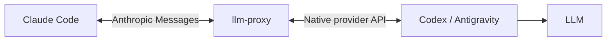

# llm-proxy

Proxy localhost cho phép **Claude Code dùng Codex hoặc Antigravity (`agy`) làm outbound**.
Codex dùng tài khoản ChatGPT subscription; AGY dùng Google OAuth và Cloud Code Assist API.
Hỗ trợ nhiều account theo từng provider; chỉ chuyển account khi lỗi cho phép failover an toàn.
Claude Code vẫn thực thi tools, sửa file và chạy terminal; proxy không chạy agent loop.



## 1. Tải source

Cần Git; trên Ubuntu/WSL có thể cài bằng `sudo apt-get install -y git`.

```sh
git clone https://github.com/nghlong3004/llm-proxy.git
cd llm-proxy
```

Chọn **một** cách chạy dưới đây.

## 2A. Cài native trên Ubuntu / WSL

```sh
sudo apt-get update
sudo apt-get install -y build-essential pkg-config cmake curl ca-certificates
curl --proto '=https' --tlsv1.2 -sSf https://sh.rustup.rs | sh -s -- -y --profile minimal --default-toolchain 1.100.0
. "$HOME/.cargo/env"
cargo install --path . --locked --root "$HOME/.local"
export PATH="$HOME/.local/bin:$PATH"
```

Binary được cài tại `~/.local/bin/llm-proxy`. Thêm dòng PATH trên vào `~/.bashrc`
hoặc `~/.zshrc` để dùng ở terminal mới.

Đăng nhập và chạy nền:

```sh
llm-proxy accounts add codex --name personal --login-method device-code
install -D -m 644 packaging/systemd/llm-proxy.service ~/.config/systemd/user/llm-proxy.service
systemctl --user daemon-reload
systemctl --user enable --now llm-proxy
curl --fail http://127.0.0.1:18765/health
```

Mở URL được in ra và nhập device code. Thêm account bằng cách lặp lệnh login với
`--name` khác. Nếu không dùng systemd, chạy `llm-proxy serve --default-model gpt-6.1-sol`.

## 2B. Chạy Docker

Cần Docker Engine và Docker Compose; không cần Rust trên host. Dockerfile build
binary ở build stage; Compose chạy container và lưu state trong named volume.

```sh
docker compose up -d --build
docker compose exec proxy llm-proxy accounts add codex --name personal --login-method device-code
curl --fail http://127.0.0.1:18765/health
```

Nếu cổng đã được dùng, chạy `LLM_PROXY_PORT=18766 docker compose up -d --build`
và dùng cùng giá trị ở các lần `up` sau.

```sh
docker compose logs -f proxy
docker compose stop
docker compose start
docker compose down
```

`down` giữ account; **`down -v` xóa account và credential**. Cổng chỉ publish ra
localhost; không expose public vì API chưa xác thực client.

## 3. Cấu hình Claude Code

Nếu chưa cài:

```sh
curl -fsSL https://claude.ai/install.sh | bash
```

Gộp các key sau vào `env` của `~/.claude/settings.json`; giữ nguyên những key đã có:

```json
{
  "env": {
    "ANTHROPIC_BASE_URL": "http://127.0.0.1:18765",
    "ANTHROPIC_AUTH_TOKEN": "local",
    "CLAUDE_CODE_DISABLE_NONESSENTIAL_TRAFFIC": "1",
    "CLAUDE_CODE_DISABLE_NONSTREAMING_FALLBACK": "1",
    "CLAUDE_CODE_AUTO_MODE_SERVER": "0"
  }
}
```

Nếu đổi host port, sửa `ANTHROPIC_BASE_URL` tương ứng. Mở terminal/phiên mới, vào
project cần làm và chạy:

```sh
claude
```

Chọn Auto mode bằng `Shift+Tab` khi cần. Biến `CLAUDE_CODE_AUTO_MODE_SERVER=0`
dùng classifier phía client, không bỏ kiểm tra quyền.

## 4. Account và config

Native:

```sh
llm-proxy accounts status                         # cache offline, tất cả provider có account
llm-proxy accounts status codex                   # lọc đúng provider
llm-proxy accounts status codex --refresh         # chủ động gọi provider để cập nhật
llm-proxy accounts status --output-format json    # dữ liệu status công khai, không credential
llm-proxy accounts reset-quota codex ACCOUNT_ID   # chỉ xem trước, chưa tiêu reset
llm-proxy accounts reset-quota codex ACCOUNT_ID --yes
llm-proxy accounts remove ACCOUNT_ID
```

`accounts status` mặc định chỉ đọc cache: không cần model/config hợp lệ, credential hay mạng.
Dấu `* active` thuộc từng provider. Usage ghi rõ nguồn và tuổi quan sát; cache có thể
đã cũ. Nếu `--refresh` lỗi, dữ liệu cache vẫn được in riêng với lỗi và lệnh trả mã
khác 0. `unknown` là chưa biết, `unsupported` là không hỗ trợ; cả hai **không phải 0**.
Cửa sổ quota, thời lượng và thời điểm reset do provider định nghĩa, không mặc định
provider nào cũng có quota 5 giờ/tuần.

Nếu anh dùng lượt reset bên Codex CLI, chạy `llm-proxy accounts status codex --refresh`
để proxy nhận quota đã phục hồi. Khi Codex xác nhận `allowed=true`, lệnh gỡ cờ
hết quota local cho đúng account/generation và hiện trạng thái mới ngay. Nó không
đổi account đang active, không gỡ lỗi cần đăng nhập lại và không tự tiêu lượt reset.
Dữ liệu thiếu, lỗi cập nhật hoặc `%` quota đơn thuần không đủ để gỡ cờ. Không có
polling nền; lệnh `status` không có `--refresh` vẫn chỉ đọc cache.

Phân biệt ba loại thông tin:

- **Scheduled reset**: thời điểm quota cửa sổ tự phục hồi, không phải thao tác mua thêm.
- **Prepaid credits**: số dư trả trước, trạng thái unlimited/spend-blocked nếu được cung cấp;
  không phải số lần reset quota.
- **BANKED resets**: quyền reset đã tích lũy, có số lượng và hạn dùng nếu provider cung cấp.
  `reset-quota --yes` yêu cầu tiêu một quyền này; không mua credits và không chỉ đợi lịch reset.
  Không có `--yes` thì chỉ xem trước. Khả năng đọc live/reset tùy provider; provider tương lai
  có thể chỉ hỗ trợ một phần, dữ liệu thiếu không được tự suy thành 0.

Nếu timeout sau khi gửi reset, kết quả có thể **chưa xác định** và reset có thể đã bị tiêu.
Giữ request ID được in ra; không tạo yêu cầu mới. Chỉ khi chủ động muốn đối soát/thử lại
cùng yêu cầu, dùng đúng ID đó:

```sh
llm-proxy accounts reset-quota codex ACCOUNT_ID --yes --retry REQUEST_ID
```

Proxy không tự thử lại mutation; thời gian provider lưu idempotency **không được bảo đảm**.
Lệnh in outcome chính xác, request ID và lỗi đối soát/cập nhật sau reset nếu có.

Tất cả thao tác account dùng nhóm `accounts`: `add <provider>`, `status [provider]`,
`reset-quota <provider> ACCOUNT_ID`, và `remove ACCOUNT_ID_OR_PREFIX`.
`remove` nhận UUID đầy đủ hoặc prefix từ **8 ký tự**, chỉ xóa khi khớp duy nhất;
khớp nhiều account thì phải nhập dài hơn. `reset-quota` vẫn cần UUID đầy đủ.

Tương thích lệnh cũ: `accounts login --name personal --login-method device-code`
vẫn đăng nhập Codex; `accounts list` và JSON của nó giữ định dạng cũ. Các lệnh
cấp đầu `login`, `status`, `reset-quota` vẫn hoạt động nhưng ẩn khỏi help chính.
`accounts add` bắt buộc có provider (`codex` hoặc `agy`).

Docker: thêm `docker compose exec proxy` trước các lệnh trên.

Config native nằm tại `~/.local/state/llm-proxy/config.toml` (hoặc
`$XDG_STATE_HOME/llm-proxy/config.toml`); Docker tại `/var/lib/llm-proxy/state/config.toml`.
Dùng [config.example.toml](config.example.toml) khi cần đổi model hoặc alias.
Thay config cần restart proxy; thêm/xóa account không cần restart.

## Antigravity (`agy`)

Adapter Rust native, **không cần chạy thêm proxy Node**. OAuth client ID/secret không
được nhúng trong source. Cung cấp cấu hình client được phép sử dụng qua môi trường
của tiến trình proxy (không phải `~/.claude/settings.json`), rồi đăng nhập trên host/WSL:

```sh
export LLM_PROXY_AGY_CLIENT_ID='<oauth-client-id>'
export LLM_PROXY_AGY_CLIENT_SECRET='<oauth-client-secret>'
llm-proxy accounts add agy --name google-personal
llm-proxy accounts status agy
```

Các giá trị trên chỉ là placeholder; không commit giá trị thật vào repo. Tiến trình
`serve` cũng cần hai biến này để refresh token; nếu chạy systemd/container, truyền
chúng qua cơ chế secret/environment private của môi trường triển khai. Client OAuth
phải được dịch vụ chấp nhận; tạo client Google bất kỳ không bảo đảm có quyền AGY.
Thiếu cấu hình sẽ báo lỗi trước login/token exchange, không vô hiệu hóa account và
không ảnh hưởng startup chỉ dùng Codex hay đọc status offline.

Mở URL được in ra, đăng nhập Google và cho phép callback về
`http://localhost:51121/oauth-callback`. Không có device-code login hay import credential
của ứng dụng Antigravity. Proxy lưu token riêng trong state private; identity gồm user ID
và project được Google trả về. Login có thể onboard project khi tài khoản chưa có;
không tự chọn project ID giả. Nếu callback không tới WSL, cần cấu hình localhost forwarding;
không mở callback ra wildcard/public. Login bên trong Docker chưa được hỗ trợ bởi cấu hình
publication hiện tại; không publish callback lên mạng để khắc phục.

Ví dụ gộp vào `config.toml` để dùng AGY cho hội thoại, vẫn dùng Codex cho classifier:

```toml
default_provider = "agy"
default_model = "claude-sonnet-4-6"

[auto_review]
provider = "codex"
model = "gpt-6-luna"
```

Classifier này cần account Codex riêng. AGY chưa hỗ trợ structured-output requests,
nên không dùng AGY làm classifier Auto mode; lỗi classifier luôn trả lỗi, không tự duyệt.
Giữ `CLAUDE_CODE_AUTO_MODE_SERVER=0` trên client nếu dùng client classifier.

Hoặc giữ default Codex, chỉ chuyển một alias sang AGY:

```toml
default_provider = "codex"
default_model = "gpt-6.1-sol"

[aliases]
sonnet = "claude-sonnet-4-6"

[models."claude-sonnet-4-6"]
provider = "agy"
```

Model ID phải là ID canonical do AGY phục vụ. `claude-sonnet-4-6` và
`claude-opus-4-6-thinking` là ví dụ từ source tham khảo, **không phải bảo đảm entitlement**;
proxy không ngầm đổi model mới thành model cũ. Đăng ký model khác qua `[models."ID"]`.
Route theo thứ tự: `auto_review.provider` tường minh → policy của model hiệu lực →
`default_provider`. Không failover xuyên provider hoặc đổi model khi gặp lỗi.

Bản đầu hỗ trợ text, ảnh base64, function tools/tool results trên Claude, SSE và buffered
response từ cùng stream, cùng thought-signature replay có kiểm tra account/generation/model.
Gemini hiện chỉ hỗ trợ text/ảnh; function tools của Gemini, hosted search, compaction,
structured output và forced tool choice chưa hỗ trợ sẽ trả lỗi trước dispatch.
Schema tools có constraint phong phú được giữ nguyên qua `parametersJsonSchema` thay vì
bị bỏ constraint; khả năng chấp nhận trường này trên API nội bộ chưa được kiểm live.
Token count vẫn là ước lượng local, không phải tokenizer/quota chính thức của Google.

`accounts status agy` chỉ đọc metadata offline. Usage live và banked quota reset của AGY
hiện báo `unsupported`, không bịa số 0. Generic 429/`RESOURCE_EXHAUSTED`, lỗi capacity,
permission/model, mạng hoặc 5xx không đủ để đánh dấu account hết quota hay replay request.

Đây là API nội bộ, có thể đổi hoặc giới hạn tài khoản; cần tự kiểm tra điều khoản và quyền
sử dụng dịch vụ. Tích hợp mới chỉ được kiểm bằng mock/local, **chưa xác minh live**.
Xem [provenance và giới hạn](docs/antigravity.md).

## 5. Cập nhật phiên bản mới

Trong thư mục source đã clone:

**Native:**

```sh
git pull --ff-only
cargo install --path . --locked --force --root "$HOME/.local"
install -D -m 644 packaging/systemd/llm-proxy.service ~/.config/systemd/user/llm-proxy.service
systemctl --user daemon-reload
systemctl --user restart llm-proxy
```

**Docker:**

```sh
git pull --ff-only
docker compose up -d --build
```

Account được giữ lại; không cần login lại chỉ vì cập nhật binary/image.
